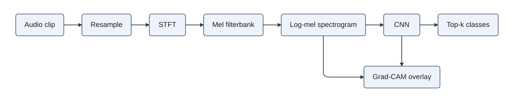

# AudioScope

Classify environmental sounds by turning audio into spectrograms and training a convolutional network on them.

## Overview

AudioScope is a learning and portfolio project. It takes short recordings of everyday sounds, converts each clip into a time–frequency image, and trains a convolutional neural network (CNN) to predict the sound class. The point of the project is to make that pipeline visible: from the waveform, through a spectrogram, to a prediction and a map of the time and frequency regions that drove it.

The work sits next to two other projects by the same author: [VisionClassify](https://github.com/cendysaputra/VisionClassify), a CNN image classifier trained on CIFAR-10, and [VecScope](https://github.com/cendysaputra/VecScope), an explorer for tokenization and embeddings. AudioScope applies the same kind of convolutional classifier to sound, using the spectrogram as the image.

The primary dataset is [ESC-50](https://github.com/karolpiczak/ESC-50). An optional second dataset is [UrbanSound8K](https://urbansounddataset.weebly.com/urbansound8k.html).

**Status.** The pipeline, the evaluation harness, and the Streamlit demo are implemented, and every ESC-50 stage in the plan has a reportable 5-fold run: the baseline CNN at 77.2%, augmentation variants within about a point of it, an ImageNet ResNet-18 at 84.2%, a frozen PANNs Cnn14 at 92.0% with a linear head and 92.75% with a trained `fc1`, and a Cnn14 + ResNet-18 ensemble at 92.95%. See [Results](#results). Task status and the evaluation rules are in [PLAN.md](PLAN.md).

## How it works

Each clip follows one path from audio to a class prediction.

1. **Load.** Read the clip and its sample rate.
2. **Resample.** Convert the audio to the rate the model was trained on, so every clip yields a comparable spectrogram.
3. **Spectrogram.** Compute a short-time Fourier transform (STFT), pass the magnitudes through a mel filterbank, and take the logarithm. The result is a log-mel spectrogram: time on one axis, frequency on the other. Mel-frequency cepstral coefficients (MFCCs) are an optional extra representation for comparison.
4. **CNN.** A convolutional network reads the spectrogram as a single-channel image and outputs a score for each class.
5. **Prediction.** Softmax turns those scores into confidences. The demo shows the top-k classes. Grad-CAM highlights the time–frequency regions that contributed most to the chosen class.



Training follows the same front end. A small CNN is the baseline. Later runs add spectrogram and waveform augmentation, then compare transfer from an ImageNet-pretrained network and from pretrained audio models. The full training plan is in [PLAN.md](PLAN.md).

## Features

- Build STFT and log-mel spectrograms with torchaudio, with MFCCs available as an optional feature.
- Train a small CNN, then the same model with augmentation, then a transfer-learning comparison.
- Evaluate with ESC-50's official 5-fold cross-validation and report mean and standard deviation across folds.
- Demo in Streamlit: upload a file or record from the microphone, view the waveform and spectrogram, and read the top-k classes with confidence.
- Overlay Grad-CAM on the spectrogram so the time and frequency evidence for a prediction is visible.

## Datasets

Audio files are downloaded locally and are not part of this repository. Each dataset keeps its own license. The MIT license of this code does not cover the recordings.

### ESC-50 (primary)

[ESC-50](https://github.com/karolpiczak/ESC-50) (Piczak, 2015) contains 2,000 five-second clips, 50 classes, and 40 clips per class. Clips are mono and sampled at 44.1 kHz. The classes fall into five groups: animals, natural soundscapes and water, human non-speech sounds, interior and domestic sounds, and exterior and urban noises. The release defines five cross-validation folds. Clips that come from the same source recording stay in the same fold. The official citation and the dataset license are on the project page. The paper is listed in [PLAN.md](PLAN.md).

### UrbanSound8K (optional extension)

[UrbanSound8K](https://urbansounddataset.weebly.com/urbansound8k.html) (Salamon, Jacoby, and Bello, 2014) is a larger urban-sound set with 10 classes and 10 predefined folds. It is a later extension for checking whether the same pipeline transfers to a second label set. It is not required for the first milestone.

## Tech stack

| Piece | Role |
| --- | --- |
| Python | Language for training, evaluation, and the demo |
| PyTorch | Models, loss, and the training loop |
| torchaudio | Resampling, STFT, and mel spectrograms |
| soundfile | Reading WAV/FLAC/OGG/MP3 (librosa as fallback decoder) |
| librosa | Reference check against torchaudio, mel-band center frequencies |
| matplotlib | Saved figures for waveforms, spectrograms, and confusion matrices |
| Streamlit | Upload, record, visualize, and predict in the browser |

Accuracy, macro F1, per-class accuracy, and confusion matrices are computed in `src/audioscope/eval/metrics.py` (checked against scikit-learn in the tests). Each run saves its package versions in `environment.txt`.

## Project structure

```text
AudioScope/
├── README.md
├── PLAN.md
├── LICENSE
├── pyproject.toml
├── docs/                    # pipeline figure
├── configs/                 # one YAML file per experiment (baseline, augment-*, transfer-*)
├── data/                    # local datasets and pretrained weights (not committed)
├── notebooks/               # 01 folds + spectrograms, 02 torchaudio-vs-librosa check
├── src/audioscope/
│   ├── data/                # download, metadata, official folds, cached waveforms
│   ├── features/            # loading, resampling, log-mel, MFCC, normalization
│   ├── models/              # baseline CNN, ImageNet ResNet, PANNs Cnn14, Grad-CAM
│   ├── train/               # training loop and augmentation
│   ├── eval/                # metrics, reports, cross-validation driver
│   ├── inference.py         # load a checkpoint and score audio with its own front end
│   └── viz.py               # waveform / spectrogram figures in seconds and hertz
├── eval/                    # crossval.py, feature_check.py, results_table.py
│   └── runs/                # one directory per run (checkpoints not committed)
├── app/streamlit_app.py     # Streamlit demo
└── tests/
```

`src/audioscope/` is the library. `eval/` holds the scripts that produce the numbers this README is allowed to quote. A score without a matching run in `eval/runs/` does not get written up.

## Getting started

### 1. Install

```bash
python -m venv .venv
source .venv/bin/activate
pip install -e ".[app,dev]"
```

### 2. Download the data

```bash
python -m audioscope.data.download --dataset esc50 --dest data/esc50
python -m audioscope.data.download --weights resnet18 cnn14   # only for the transfer-learning configs
```

The ESC-50 clips can also be taken from the [official repository](https://github.com/karolpiczak/ESC-50). Keep them under `data/` and out of git.

### 3. Evaluate with 5-fold cross-validation

```bash
python eval/crossval.py --config configs/baseline.yaml --out eval/runs/baseline-v1
```

For each official fold the script trains on the other four (with a validation split taken from them), selects the checkpoint on that validation split, and scores the held-out fold once. It writes `config.yaml`, `train.log`, `environment.txt`, `metrics.json` (per-fold and mean ± std accuracy and macro F1, per-class accuracy, git revision), confusion matrices as CSV and PNG, `predictions.csv`, and one checkpoint per fold. A run is marked `"reportable": true` only if it covers every fold from a clean git tree.

```bash
python eval/results_table.py          # Markdown table of reportable runs
python eval/feature_check.py --n 64   # torchaudio vs librosa tolerance check
pytest                                # folds, features, augmentation, models, a tiny overfit
```

To train a single checkpoint (for the demo) without scoring its held-out fold:

```bash
python -m audioscope.train --config configs/baseline.yaml --holdout-fold 1 --out checkpoints/baseline.pt
```

### 4. Run the Streamlit app

```bash
streamlit run app/streamlit_app.py
```

The app lists checkpoints under `eval/runs/*/fold*/model.pt` and `checkpoints/*.pt` and rebuilds the front end from the config saved in the selected checkpoint. It accepts an upload (WAV, FLAC, OGG, MP3) or a microphone recording and shows the waveform, the log-mel spectrogram with mel-band center frequencies on the y axis, the top-k classes, and a Grad-CAM overlay. Without a checkpoint it still draws the waveform and spectrogram and says that predictions need a trained model. Checkpoints are not committed; create one with step 3.

## Results

All AudioScope numbers below come from `eval/runs/<run-id>/metrics.json`, written by `eval/crossval.py` on ESC-50's five official folds. Each row is the mean ± sample standard deviation over the five held-out test folds. The table is generated by `python eval/results_table.py`. Run directories (config, log, environment, metrics, confusion matrices, predictions) are committed; checkpoints are not.

<!-- results-table:start -->
| Run | Config | Model | Accuracy % (mean ± std) | Macro F1 % (mean ± std) | Folds | Git |
| --- | --- | --- | --- | --- | --- | --- |
| `augment-combined-v1` | `configs/augment-combined.yaml` | baseline_cnn | 75.4 ± 2.2 | 74.6 ± 2.7 | 5 | `4ece723` |
| `augment-mixup-v1` | `configs/augment-mixup.yaml` | baseline_cnn | 77.0 ± 2.5 | 76.1 ± 2.8 | 5 | `6ed7063` |
| `augment-noise-v1` | `configs/augment-noise.yaml` | baseline_cnn | 78.1 ± 2.8 | 77.5 ± 2.8 | 5 | `6ed7063` |
| `augment-specaugment-v1` | `configs/augment-specaugment.yaml` | baseline_cnn | 76.5 ± 0.9 | 75.7 ± 1.3 | 5 | `6ed7063` |
| `augment-timeshift-v1` | `configs/augment-timeshift.yaml` | baseline_cnn | 76.4 ± 2.2 | 75.7 ± 2.3 | 5 | `6ed7063` |
| `baseline-v1` | `configs/baseline.yaml` | baseline_cnn | 77.2 ± 1.8 | 76.5 ± 1.9 | 5 | `0af3341` |
| `ensemble-cnn14fc1-resnet18-v1` | `eval/runs/ensemble-cnn14fc1-resnet18-v1/config.yaml` | ensemble(panns_cnn14, resnet) | 93.0 ± 1.6 | 92.7 ± 1.6 | 5 | `a56edd9` |
| `transfer-panns-cnn14-fc1-v1` | `configs/transfer-panns-cnn14-fc1.yaml` | panns_cnn14 | 92.8 ± 2.2 | 92.6 ± 2.3 | 5 | `a56edd9` |
| `transfer-panns-cnn14-frozen-v1` | `configs/transfer-panns-cnn14-frozen.yaml` | panns_cnn14 | 92.0 ± 1.9 | 91.8 ± 2.0 | 5 | `c2a0e05` |
| `transfer-resnet18-v1` | `configs/transfer-resnet18.yaml` | resnet | 84.2 ± 3.2 | 83.7 ± 3.4 | 5 | `80d91e6` |
<!-- results-table:end -->

Hardware for these runs: 4 CPU cores, no GPU (see each run's `environment.txt`).

### Baseline

`baseline-v1` is the Stage 1 CNN: four conv–BN–ReLU–max-pool blocks (32/64/128/256 channels, 0.40M parameters) on 64-band log-mel spectrograms at 22.05 kHz, 60 epochs of AdamW with the checkpoint chosen on a validation split from the training folds. Per-fold test accuracy ranged from 75.5% (fold 3) to 80.25% (fold 4). The weakest classes, by per-class accuracy averaged over folds, were helicopter (25%), washing machine (47.5%), airplane (52.5%), and water drops (55%); the confusion matrix is in [`eval/runs/baseline-v1/confusion_matrix.png`](eval/runs/baseline-v1/confusion_matrix.png).

### Augmentation (Stage 2)

Each `augment-*-v1` run is the baseline config with one training-time augmentation switched on and nothing else changed: same model, front end, 60-epoch budget, seeds, and folds. Augmentation strengths were set once from common defaults and not tuned.

Because every run uses the same five test folds, the useful comparison is the per-fold difference from `baseline-v1` (accuracy, percentage points):

| Run | Fold 1 | Fold 2 | Fold 3 | Fold 4 | Fold 5 | Mean diff | Folds better |
| --- | --- | --- | --- | --- | --- | --- | --- |
| SpecAugment (2 freq + 2 time masks) | -0.75 | -1.25 | +1.00 | -2.25 | -0.50 | -0.75 | 1 / 5 |
| mixup (alpha 0.2) | +0.50 | -2.00 | +2.00 | +0.50 | -2.00 | -0.20 | 3 / 5 |
| time shift (up to 0.5 of the clip) | 0.00 | -4.25 | +2.00 | -2.75 | +1.00 | -0.80 | 2 / 5 |
| additive noise (SNR 10–40 dB, p = 0.5) | +1.25 | -2.25 | +2.25 | +2.00 | +1.25 | +0.90 | 4 / 5 |
| all four combined (`augment-combined-v1`) | -2.50 | -2.00 | 0.00 | -1.25 | -3.75 | -1.90 | 0 / 5 |

None of the four separate augmentations moves mean accuracy by more than its fold-to-fold spread. Additive noise is the only one ahead on most folds (+0.9 points on average, 4 of 5 folds), which is a weak signal from five folds, not an established gain. Stacking all four was worse than the baseline on every fold but one tie (-1.9 points on average), so the combination is not used further. On the classes the baseline found hardest, noise raised airplane from 52.5% to 70% and water drops from 55% to 62.5%; helicopter stayed at 25%. A likely reason the spectrogram augmentations did not help is the fixed 60-epoch budget, which was chosen for the unaugmented baseline; that is untested here.

### Transfer learning (Stage 3)

`transfer-panns-cnn14-frozen-v1` uses PANNs Cnn14 (Kong et al., 2020, "PANNs: Large-Scale Pretrained Audio Neural Networks for Audio Pattern Recognition"; checkpoint `Cnn14_mAP=0.431.pth`, pretrained on AudioSet) as a **frozen** feature extractor: each clip runs once through the trunk at 32 kHz with Cnn14's own front end, and only a new 2048 → 50 linear head is trained on the cached embeddings. It reached 92.0 ± 1.9% accuracy, between 14.0 and 15.25 points above `baseline-v1` on every fold. Its weakest classes were helicopter (57.5%), washing machine (70%), and airplane (72.5%), the same three the baseline struggled with, at much higher levels. This is a linear probe, not fine-tuning: full fine-tuning of the 80M-parameter model (`configs/transfer-panns-cnn14.yaml`) is a GPU job and was not run. Whether any ESC-50 recordings also appear in AudioSet was not checked.

`transfer-resnet18-v1` fine-tunes torchvision's ImageNet ResNet-18 (He et al., 2016; `ResNet18_Weights.IMAGENET1K_V1`) on the same 22.05 kHz, 64-band log-mel input as the baseline, repeated to three channels and resized to 224 × 224. The backbone is frozen for the first 3 of 30 epochs, then the whole network trains at learning rate 3e-4 with SpecAugment. It reached 84.2 ± 3.2% accuracy, 4.5 to 9.25 points above `baseline-v1` on every fold. Its weakest classes were water drops (47.5%), wind (55%), and helicopter (57.5%). On fold 1 the selected checkpoint was the last epoch, so that fold may not have converged within the 30-epoch budget.

Ranking on every fold: frozen Cnn14 > ResNet-18 > baseline. Cnn14 was ahead of ResNet-18 by 5.75 to 10 points per fold, even though only its linear head was trained. The audio-pretrained representation helped more than the ImageNet one, but the two runs also differ in sample rate, mel settings, and model size, so this is a comparison of the two recipes, not of pretraining data alone.

### Improving the Cnn14 probe and ensembling

Variants of the frozen-Cnn14 probe were compared on the validation splits only (mean over the five folds; test folds were not scored): the linear probe (92.6% validation), the same probe trained on eight extra augmented trunk passes per clip (time shift, noise, SpecAugment; 92.7%), training `fc1` (initialized from the AudioSet checkpoint, learning rate scaled by 0.1) together with the head (93.3%), `fc1` with augmented passes (93.3%), and either probe with feature-space mixup (92.7–92.8%). The simplest variant with the best validation score, training `fc1`, was then run once on the test folds as `transfer-panns-cnn14-fc1-v1`: 92.75 ± 2.2%, ahead of the linear probe on four folds and behind on one (mean +0.75 points).

`ensemble-cnn14fc1-resnet18-v1` averages the class probabilities of that run and `transfer-resnet18-v1` (`eval/ensemble.py`). The weights are chosen per fold on the validation split, on a 0.1 grid; Cnn14 got 0.4 to 1.0 of the weight. It reached 92.95 ± 1.6%, 0.2 points above Cnn14 alone. That gain is smaller than the fold-to-fold spread and is not established by five folds.

Published ESC-50 results for PANNs and other pretrained models are not quoted here: the papers could not be checked from the environment these runs were made in, and the evidence rule requires numbers copied from the source.

### External reference points (not AudioScope measurements)

From Piczak (2015), the ESC-50 paper, under the same 5-fold protocol:

| Reference | ESC-50 accuracy |
| --- | --- |
| Human listeners (crowdsourced, rough estimate) | 81.3% |
| Random forest on MFCC + ZCR | 44.3% |
| Linear SVM on MFCC + ZCR | 39.6% |
| k-NN on MFCC + ZCR | 32.2% |

The baseline is about 33 points above the paper's best classical baseline and about 4 points below the crowdsourced human estimate. The human figure is a rough estimate, not a ceiling the project is required to pass.

## Roadmap

Done, with reportable runs in `eval/runs/`: official-fold data pipeline, log-mel front end checked against librosa, baseline CNN, four separate augmentations and their combination, ImageNet ResNet-18 fine-tuning, a frozen PANNs Cnn14 linear probe, and the Streamlit demo with Grad-CAM.

Not done:

- Full fine-tuning of PANNs Cnn14 (`configs/transfer-panns-cnn14.yaml`). It needs a GPU; all runs here were CPU-only.
- UrbanSound8K. The loader and `configs/urbansound8k-baseline.yaml` exist, but the 10-fold run was not made, so no UrbanSound8K number is reported.
- Tuning augmentation strength and epoch budget per augmentation.

## Related projects

- [VisionClassify](https://github.com/cendysaputra/VisionClassify) — CNN image classification on CIFAR-10.
- [VecScope](https://github.com/cendysaputra/VecScope) — exploration of tokenization and embeddings.

## License

The code is released under the [MIT License](LICENSE). Dataset recordings stay under the licenses of their publishers (ESC-50: CC BY-NC) and are not redistributed here. Pretrained weights keep their own licenses: torchvision ResNet-18 (BSD-3-Clause) and PANNs Cnn14 (CC BY 4.0, Zenodo record 3987831).
