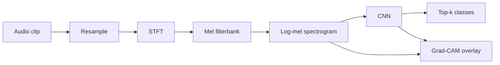

# AudioScope

Classify environmental sounds by turning audio into spectrograms and training a convolutional network on them.

## Overview

AudioScope is a learning and portfolio project. It takes short recordings of everyday sounds, converts each clip into a time–frequency image, and trains a convolutional neural network (CNN) to predict the sound class. The point of the project is to make that pipeline visible: from the waveform, through a spectrogram, to a prediction and a map of the time and frequency regions that drove it.

The work sits next to two other projects by the same author: [VisionClassify](https://github.com/cendysaputra/VisionClassify), a CNN image classifier trained on CIFAR-10, and [VecScope](https://github.com/cendysaputra/VecScope), an explorer for tokenization and embeddings. AudioScope applies the same kind of convolutional classifier to sound, using the spectrogram as the image.

The primary dataset is [ESC-50](https://github.com/karolpiczak/ESC-50). An optional second dataset is [UrbanSound8K](https://urbansounddataset.weebly.com/urbansound8k.html).

**Status.** This repository is at the planning stage. It contains this README and the project plan. Training code, a trained model, and the demo app are still to be built. See [plan.md](plan.md).

## How it works

Each clip follows one path from audio to a class prediction.

1. **Load.** Read the clip and its sample rate.
2. **Resample.** Convert the audio to the rate the model was trained on, so every clip yields a comparable spectrogram.
3. **Spectrogram.** Compute a short-time Fourier transform (STFT), pass the magnitudes through a mel filterbank, and take the logarithm. The result is a log-mel spectrogram: time on one axis, frequency on the other. Mel-frequency cepstral coefficients (MFCCs) are an optional extra representation for comparison.
4. **CNN.** A convolutional network reads the spectrogram as a single-channel image and outputs a score for each class.
5. **Prediction.** Softmax turns those scores into confidences. The demo shows the top-k classes. Grad-CAM highlights the time–frequency regions that contributed most to the chosen class.



Training follows the same front end. A small CNN is the baseline. Later runs add spectrogram and waveform augmentation, then compare transfer from an ImageNet-pretrained network and from pretrained audio models. The full training plan is in [plan.md](plan.md).

## Features

Planned behavior of the project:

- Build STFT and log-mel spectrograms with torchaudio, with MFCCs available as an optional feature.
- Train a small CNN, then the same model with augmentation, then a transfer-learning comparison.
- Evaluate with ESC-50's official 5-fold cross-validation and report mean and standard deviation across folds.
- Demo in Streamlit: upload a file or record from the microphone, view the waveform and spectrogram, and read the top-k classes with confidence.
- Overlay Grad-CAM on the spectrogram so the time and frequency evidence for a prediction is visible.

## Datasets

Audio files are downloaded locally and are not part of this repository. Each dataset keeps its own license. The MIT license planned for this code does not cover the recordings.

### ESC-50 (primary)

[ESC-50](https://github.com/karolpiczak/ESC-50) (Piczak, 2015) contains 2,000 five-second clips, 50 classes, and 40 clips per class. Clips are mono and sampled at 44.1 kHz. The classes fall into five groups: animals, natural soundscapes and water, human non-speech sounds, interior and domestic sounds, and exterior and urban noises. The release defines five cross-validation folds. Clips that come from the same source recording stay in the same fold. The official citation and the dataset license are on the project page. The paper is listed in [plan.md](plan.md).

### UrbanSound8K (optional extension)

[UrbanSound8K](https://urbansounddataset.weebly.com/urbansound8k.html) (Salamon, Jacoby, and Bello, 2014) is a larger urban-sound set with 10 classes and 10 predefined folds. It is a later extension for checking whether the same pipeline transfers to a second label set. It is not required for the first milestone.

## Tech stack

| Piece | Role |
| --- | --- |
| Python | Language for training, evaluation, and the demo |
| PyTorch | Models, loss, and the training loop |
| torchaudio | Loading, resampling, STFT, and mel spectrograms |
| librosa | Spectrogram figures and a reference check against torchaudio |
| matplotlib | Saved figures for waveforms, spectrograms, and confusion matrices |
| Streamlit | Upload, record, visualize, and predict in the browser |

Metric computation is planned around standard classification scores (accuracy, macro F1, confusion matrix). Exact package versions will be recorded with each evaluation run.

## Planned project structure

The tree below is the layout the implementation will follow. Only `README.md` and `plan.md` exist today.

```text
AudioScope/
├── README.md
├── plan.md
├── configs/                 # one YAML file per experiment
├── data/                    # local datasets (not committed)
├── notebooks/               # exploration of folds and spectrograms
├── src/audioscope/
│   ├── data/                # download, fold splits, datasets
│   ├── features/            # resample, STFT, log-mel, MFCC
│   ├── models/              # baseline CNN and transfer backbones
│   ├── train/               # training loop and augmentation
│   └── eval/                # metric functions used by scripts
├── eval/                    # scripts that write logs and metrics JSON
├── app/                     # Streamlit demo
└── tests/
```

`src/audioscope/` is the library. `eval/` holds the scripts that produce the numbers this README is allowed to quote. A score without a matching run in `eval/` does not get written up.

## Getting started

**Planned / work in progress.** Nothing below can be run yet. There is no package, downloader, trainer, evaluator, or Streamlit app in the tree. The commands are the interface those pieces will have, written down so the later implementation has a fixed shape.

### 1. Install (planned)

```bash
python -m venv .venv
source .venv/bin/activate
pip install -e ".[app,dev]"
```

### 2. Download the data (planned)

```bash
python -m audioscope.data.download --dataset esc50 --dest data/esc50
```

The same clips can be downloaded from the [official ESC-50 repository](https://github.com/karolpiczak/ESC-50). Keep them under `data/` and leave them out of git.

### 3. Train (planned)

```bash
python -m audioscope.train --config configs/baseline.yaml
```

Later configs will cover augmentation and transfer learning. Every run records its config and the code revision.

### 4. Evaluate (planned)

```bash
python -m audioscope.eval.crossval \
  --config configs/baseline.yaml \
  --out eval/runs/<run-id>
```

The script trains or loads one model per official fold, writes a log, and writes `metrics.json` with per-fold scores, the mean, and the standard deviation. Hyperparameters are chosen on the training folds only.

### 5. Run the Streamlit app (planned)

```bash
streamlit run app/streamlit_app.py
```

The app will load a saved checkpoint and the config that belongs to it. Until a checkpoint exists, the planned app still draws the waveform and the spectrogram and states that there is no model to score the clip.

## Results

No model has been trained, and no evaluation has been run. This section will report accuracy and macro F1 as the mean and standard deviation across the five official ESC-50 folds once those figures exist.

A figure belongs here only when a script in `eval/` produced it and saved both a log and a metrics JSON file. That JSON records the model, the config, and the code version of the run. Scores that were not produced this way will not be added to this file.

## Roadmap

The work is sequenced so that a reproducible baseline exists before augmentation, transfer learning, or the demo claim a gain. Detail, task lists, and the evaluation rules are in [plan.md](plan.md).

1. Repository skeleton, data download, and official fold splits.
2. Log-mel features, checked against a reference implementation.
3. Baseline CNN and the `eval/` harness on 5-fold cross-validation.
4. Augmentation: SpecAugment, mixup, time shift, and noise.
5. Transfer learning: an ImageNet-pretrained ResNet on spectrograms, and a pretrained audio model (PANNs or AST) as a comparison.
6. Streamlit demo with waveform, spectrogram, top-k predictions, and Grad-CAM.
7. Write the measured results back into this README from the saved metrics files.

## Related projects

- [VisionClassify](https://github.com/cendysaputra/VisionClassify) — CNN image classification on CIFAR-10.
- [VecScope](https://github.com/cendysaputra/VecScope) — exploration of tokenization and embeddings.

## License

The code in this repository is planned for release under the MIT License. A `LICENSE` file will be added with the first code commit. Dataset recordings stay under the licenses of their publishers and are not redistributed here.
