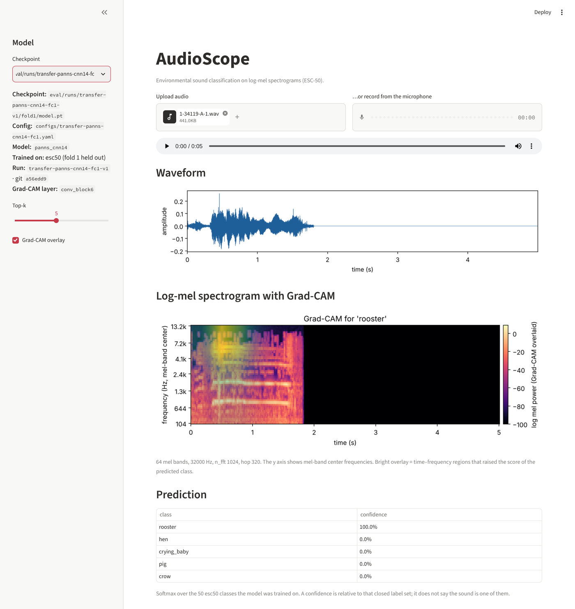
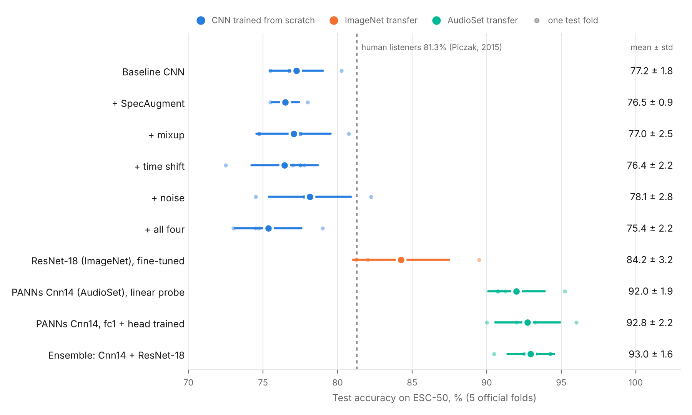

<h1 align="center">AudioScope</h1>

<p align="center">
  <b>Hear it, see it, classify it.</b><br>
  Environmental sound classification on log-mel spectrograms, with a Streamlit demo that shows <i>why</i> the model decided.
</p>

<p align="center">
  
  
  
  
  
</p>

<p align="center">
  
</p>
<p align="center"><sub>The demo on a held-out ESC-50 test clip (<code>1-34119-A-1.wav</code>, fold 1), scored by the fold-1 checkpoint of <code>transfer-panns-cnn14-fc1-v1</code>, which never saw fold 1 during training.</sub></p>

## At a glance

| | |
| --- | --- |
| **Task** | 50-class environmental sound classification on [ESC-50](https://github.com/karolpiczak/ESC-50) (2,000 five-second clips) |
| **Best result** | **93.0 ± 1.6%** accuracy for the Cnn14 + ResNet-18 ensemble, **92.8 ± 2.2%** for Cnn14 alone |
| **Protocol** | ESC-50's official 5-fold cross-validation; mean ± sample std over the five held-out test folds |
| **Demo** | upload or record audio → waveform, spectrogram, Grad-CAM, top-k classes |
| **Hardware** | 4 CPU cores, no GPU |

## How it works


1. **Load and resample** the clip to the model's sample rate (22.05 kHz for the CNNs, 32 kHz for Cnn14).
2. **Log-mel spectrogram**: STFT → 64-band mel filterbank → log. It matches librosa to within 2e-4 ([notebook](notebooks/02_feature_check.ipynb)).
3. **Classify** the spectrogram as an image with a small CNN, an ImageNet ResNet-18, or PANNs Cnn14 pretrained on AudioSet.
4. **Explain** the prediction with Grad-CAM over time and frequency.

## Results



Every number here is read from a committed `metrics.json` (click a run name), written by `eval/crossval.py` or `eval/ensemble.py`. A run is only listed if it covers all five folds from a clean git commit (`"reportable": true`). `python eval/results_table.py` regenerates the table and `python eval/plot_results.py` regenerates the chart.

<!-- results-table:start -->
| Run (links to metrics.json) | Model | Accuracy % | Per-fold accuracy % (folds 1–5) | Macro F1 % | Git |
| --- | --- | --- | --- | --- | --- |
| [`ensemble-cnn14fc1-resnet18-v1`](eval/runs/ensemble-cnn14fc1-resnet18-v1/metrics.json) | ensemble(panns_cnn14, resnet) | **93.0** ± 1.6 | 93.25 · 94.25 · 92.5 · 94.25 · 90.5 | 92.7 ± 1.6 | `a56edd9` |
| [`transfer-panns-cnn14-fc1-v1`](eval/runs/transfer-panns-cnn14-fc1-v1/metrics.json) | panns_cnn14 | **92.8** ± 2.2 | 93.25 · 92.5 · 92 · 96 · 90 | 92.6 ± 2.3 | `a56edd9` |
| [`transfer-panns-cnn14-frozen-v1`](eval/runs/transfer-panns-cnn14-frozen-v1/metrics.json) | panns_cnn14 | **92.0** ± 1.9 | 92 · 91.25 · 90.75 · 95.25 · 90.75 | 91.8 ± 2.0 | `c2a0e05` |
| [`transfer-resnet18-v1`](eval/runs/transfer-resnet18-v1/metrics.json) | resnet | **84.2** ± 3.2 | 84.25 · 81.25 · 82 · 89.5 · 84.25 | 83.7 ± 3.4 | `80d91e6` |
| [`augment-noise-v1`](eval/runs/augment-noise-v1/metrics.json) | baseline_cnn | **78.1** ± 2.8 | 78.25 · 74.5 · 77.75 · 82.25 · 78 | 77.5 ± 2.8 | `6ed7063` |
| [`baseline-v1`](eval/runs/baseline-v1/metrics.json) | baseline_cnn | **77.2** ± 1.8 | 77 · 76.75 · 75.5 · 80.25 · 76.75 | 76.5 ± 1.9 | `0af3341` |
| [`augment-mixup-v1`](eval/runs/augment-mixup-v1/metrics.json) | baseline_cnn | **77.0** ± 2.5 | 77.5 · 74.75 · 77.5 · 80.75 · 74.75 | 76.1 ± 2.8 | `6ed7063` |
| [`augment-specaugment-v1`](eval/runs/augment-specaugment-v1/metrics.json) | baseline_cnn | **76.5** ± 0.9 | 76.25 · 75.5 · 76.5 · 78 · 76.25 | 75.7 ± 1.3 | `6ed7063` |
| [`augment-timeshift-v1`](eval/runs/augment-timeshift-v1/metrics.json) | baseline_cnn | **76.4** ± 2.2 | 77 · 72.5 · 77.5 · 77.5 · 77.75 | 75.7 ± 2.3 | `6ed7063` |
| [`augment-combined-v1`](eval/runs/augment-combined-v1/metrics.json) | baseline_cnn | **75.4** ± 2.2 | 74.5 · 74.75 · 75.5 · 79 · 73 | 74.6 ± 2.7 | `4ece723` |
<!-- results-table:end -->

**What the runs show**

- **Pretraining matters most.** Cnn14, pretrained on AudioSet, beats the from-scratch CNN by about 15 points on every fold, even though only its last layers were trained. ResNet-18, pretrained on ImageNet, lands in between at 84.2%.
- **Augmentation barely moved the small CNN.** SpecAugment, mixup, time shift, and noise each stayed within about a point of the baseline. Noise did best: +0.9 points on average, and better on 4 of 5 folds. Stacking all four was worse than the baseline on four folds and tied on the fifth.
- **The gains on top of Cnn14 are small.** Training `fc1` together with the head added 0.75 points, and averaging with ResNet-18 added another 0.2. Both gains are smaller than the spread between folds.
- **The hardest classes** were helicopter, washing machine, airplane, and water drops. Each run directory has its confusion matrix next to `metrics.json` ([best run](eval/runs/ensemble-cnn14fc1-resnet18-v1/confusion_matrix.png)).

For reference, Piczak (2015) reports 81.3% for crowdsourced human listeners (a rough estimate) and 44.3% for the best classical baseline (a random forest on MFCC + ZCR) on the same folds. All model choices above were made on validation splits taken from the training folds; each test fold was scored once.

<details>
<summary>Method details per run</summary>

- **Baseline CNN**: four conv–BN–ReLU–max-pool blocks (32/64/128/256 channels, 0.40M parameters), 64-band log-mel at 22.05 kHz, 60 epochs of AdamW, with the checkpoint chosen on a validation split taken from the training folds.
- **Augmentation runs**: the baseline config with one training-time augmentation turned on and nothing else changed. Augmentation strengths were set once and not tuned.
- **ResNet-18**: torchvision `IMAGENET1K_V1`. The spectrogram is repeated to 3 channels and resized to 224 × 224. The backbone stays frozen for the first 3 of 30 epochs, then the whole network is fine-tuned at learning rate 3e-4 with SpecAugment.
- **PANNs Cnn14** (Kong et al., 2020; `Cnn14_mAP=0.431.pth`): the frozen trunk runs once per clip with its own 32 kHz front end. The linear probe trains a new 2048 → 50 head. The `fc1` variant also trains `fc1`, at 0.1× the learning rate; it was chosen over augmented trunk passes and feature-space mixup by validation accuracy. Full fine-tuning needs a GPU and was not run. Overlap between AudioSet and ESC-50 recordings was not checked.
- **Ensemble**: averages the class probabilities of the two runs, with weights chosen per fold on the validation split. Cnn14 got between 0.4 and 1.0 of the weight.

</details>

## Quick start

```bash
pip install -e ".[app,dev]"
python -m audioscope.data.download --dataset esc50 --dest data/esc50
python -m audioscope.data.download --weights resnet18 cnn14        # for the transfer configs

python eval/crossval.py --config configs/transfer-panns-cnn14-fc1.yaml --out eval/runs/my-run
streamlit run app/streamlit_app.py
```

For each of the five folds, `eval/crossval.py` trains on the other four, picks the checkpoint on a validation split taken from them, and scores the held-out fold. Each run directory gets the config, log, environment, `metrics.json`, confusion matrices, predictions, and one checkpoint per fold. The app lists every checkpoint under `eval/runs/*/fold*/model.pt`. Run the tests with `pytest`.

## Project structure

```text
src/audioscope/   library: data (folds, cache), features (log-mel, MFCC), models (CNN, ResNet, Cnn14, Grad-CAM), train, eval
eval/             crossval.py, ensemble.py, results_table.py, plot_results.py, feature_check.py
eval/runs/        one directory per run (checkpoints not committed)
configs/          one YAML per experiment
app/              Streamlit demo
notebooks/        fold checks and spectrograms, torchaudio vs librosa
tests/            folds, features, metrics, augmentation, models, overfit
```

The full plan, protocol, and evaluation rules are in [PLAN.md](PLAN.md).

## Not done yet

- Full fine-tuning of Cnn14, which needs a GPU.
- UrbanSound8K: the loader and config exist, but no run was made, so no number is reported.
- Published ESC-50 numbers for PANNs and AST are not quoted, because the papers could not be checked from the environment the runs were made in.

## Related projects

- [VisionClassify](https://github.com/cendysaputra/VisionClassify): CNN image classification on CIFAR-10.
- [VecScope](https://github.com/cendysaputra/VecScope): tokenization and embeddings explorer.

## License

Code: [MIT](LICENSE). The audio is not redistributed here; ESC-50 is CC BY-NC. Pretrained weights keep their own licenses: torchvision ResNet-18 (BSD-3-Clause) and PANNs Cnn14 (CC BY 4.0, Zenodo record 3987831).
